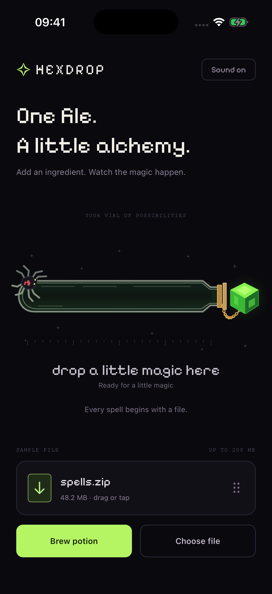
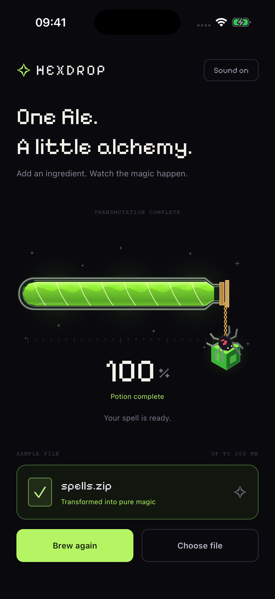

<div align="center">

# Hexdrop 🧪

**One file. A little alchemy.**

A native potion-upload experiment built with **NativeScript-Vue** and **Jolt**.

[NativeScript 9](https://nativescript.org/) · [Vue 3](https://nativescript-vue.org/) · [Jolt 0.1.0-rc.11](https://jolt.rafaelaugusto.dev/)


&nbsp;


*Captured in the iOS simulator.*

</div>

Drop an ingredient into the vial. A green flash races through the glass, the potion fills, and a spider crawls along for the ride. When the spell finishes, the stopper swings open with its little passenger still attached.

The glass, liquid, spider, chain and crystal are drawn in code. Jolt handles the motion, vector morphs, gradients and particles. The interface is made of native views.

## Take it for a spin

You will need **Node.js 22.16+**, the **NativeScript CLI**, and the toolchain for your platform: **Xcode** for iOS, or a **JDK and Android SDK** for Android.

```sh
npm ci
npm run check:versions

npm run ios
# or
npm run android
```

To choose a device explicitly:

```sh
npm run ios -- --device <device-id>
npm run android -- --device <device-id>
```

Jolt is pinned to **`0.1.0-rc.11`** in the manifest, override and lockfile. This app uses its native entry points; no optional `jolt-native` package is needed.

The [native launcher](scripts/native.sh) detects the default macOS Android SDK location and Homebrew Ruby/CocoaPods installations without changing your shell configuration.

## The interaction

- **Drag the file card** onto the vial to brew. Release it outside and Jolt springs it back into place.
- **Tap the card or Brew potion** for the same interaction without dragging.
- **Choose file** opens the system document picker. The selected name and size appear on the card.
- **Cancel** resets the current spell and stops its sound. **Brew again** starts another cycle.
- **Sound on / Sound off** remembers your preference between launches.

The ignition travels from the neck to the rounded end in **540 ms**, then the vial fills over **8.4 seconds**. The spider follows the fill with a separate climbing gait. At completion, it transfers to the stopper's pivot, so spider, crystal and chain swing together.

**This is a local interaction demo.** No file is uploaded, copied or persisted. `spells.zip` is sample metadata, not a bundled archive. The picker accepts files up to 200 MB when the provider reports a size; unknown sizes are displayed as 0 B.

## How it is put together

The screen composes three Vue components. State and input live in composables; native scene construction and playback live together under `potion/`. File access and audio use small platform adapters.

```text
src/
├── App.vue                      Screen composition and responsive layout
├── components/
│   ├── HexdropHeader.vue        Brand, introduction and sound toggle
│   ├── PotionStage.vue          Vial, progress and status copy
│   └── IngredientPanel.vue      File card, picker action and brew controls
├── composables/
│   ├── usePotion.ts             Ingredient, brew state and app lifecycle
│   └── useIngredientDrag.ts     Jolt drag, drop acceptance and card feedback
├── potion/
│   ├── potion-view.ts           Native view lifecycle and animation sequence
│   ├── potion-artwork.ts        Vector scene and reusable spider artwork
│   └── geometry.ts              Paths, morph geometry and drop bounds
├── services/
│   ├── files.ts                 File metadata, validation and formatting
│   ├── file-picker.*            iOS / Android document picker adapters
│   ├── potion-sound.ts          Cue timing, mute and background behavior
│   └── sound-player.*          AVAudioPlayer / MediaPlayer adapters
└── audio/                       Ignition and completion cues, with provenance
```

`usePotion` owns the three screen states: `ready`, `brewing` and `complete`. The native scene owns its animation clock. Cancelling invalidates the active run, so an old completion callback cannot change a newer spell. File-picker results are also ignored after the screen is disposed.

The card's gesture controller and visual feedback have separate ownership: resetting an animation does not detach drag input. Backgrounding cancels an unfinished drop, while an existing brew pauses and resumes. Permanent unload disposes the scene, audio, listeners and animation scopes.

### Where Jolt comes in

| API | Used for |
| --- | --- |
| `drag()` with `snap: [0]` | Card tracking, release velocity and spring return to its starting point |
| `animate()` / `set()` | Ignition, card absorption, spider gait and stopper swing |
| `motionValue()` / `bind()` | One fill clock driving the liquid reveal, spider position and sparks |
| `shape()` / path morphs | Glass and crystal artwork, flowing liquid and opening chain |
| `gradient()` | Liquid color, soft glows and the ignition trail |
| `particles()` | Bubbles, travelling sparks and the completion burst |
| `press()` | Button feedback |
| `motionScope()` | Animation ownership, cancellation and background lifecycle |

Jolt provides the **drag mechanics**. The app supplies the **drop rule**: the scaled, rotated card's bounding rectangle must overlap the vial target when released. The final release coordinates are checked again before accepting it. This is an in-app card interaction; importing a document uses the system picker.

The [Jolt drag API](https://jolt.rafaelaugusto.dev/guide/drag) processes finger tracking through NativeScript's synchronous gesture callbacks. Release motion plays through native animation drivers. The potion's view tracks, shape morphs and particle effects also run natively; JavaScript samples the progress text at 10 Hz. There is no JavaScript drawing loop.

### Sound and motion preferences

The two sound cues match the reference: ignition and completion. The filling interval is silent. [Source metadata](src/audio/source.json) records the cuts.

Audio uses **AVAudioPlayer** on iOS and **MediaPlayer** on Android. Muting keeps the playback clock running silently, so unmuting stays in sync. Cancellation stops playback; backgrounding pauses it. iOS respects the silent switch and mixes with other audio.

The ignition and continuing stopper swing are skipped when Reduce Motion is enabled; other transitions follow Jolt's reduced-motion behavior. Every essential action is available through a labeled button or tap target.

## Development and verification

```sh
npm run typecheck
npm test
npm run check:versions

npm run build:ios
npm run build:android
```

The tests exercise Jolt RC.11's actual path parser and check morph compatibility, drop geometry (including scale and rotation), file limits and size formatting.

For a quicker JavaScript-only check, use `npm run bundle:ios` or `npm run bundle:android`. Run the corresponding `prepare:*` command or a normal native build before launching afterward; bundling alone does not generate the runtime's `package.json`.

| Platform | Validation |
| --- | --- |
| iOS | Native build and interaction checks on the iPhone 17 / iOS 26.2 simulator |
| Android | JavaScript bundle checked; native device/emulator execution still unverified |

Local captures and validation reports go in the ignored `artifacts/` directory. The screenshots above live in `docs/images/` so they remain available with the repository. Physical-device performance has not been measured.

## Credits

Inspired by the potion-upload animation supplied as the project's visual reference, originally made with React Native, Expo, Skia and Reanimated. Hexdrop recreates the scene with NativeScript-Vue and Jolt; all visual artwork is constructed in code. The sound effects are excerpts from the supplied recording.

Motion and rendering: [Jolt](https://jolt.rafaelaugusto.dev/), by Rafael Augusto / Cortex Labs. Typeface: **Pixelify Sans**, distributed under the [SIL Open Font License](src/fonts/OFL-PixelifySans.txt).
